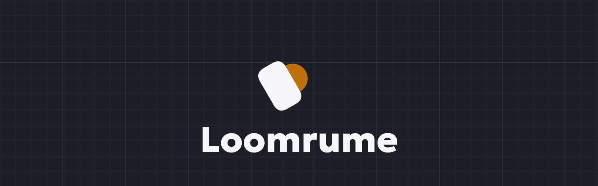
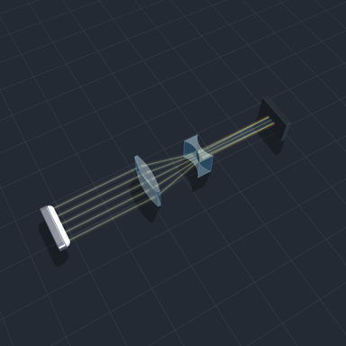
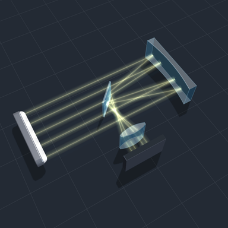
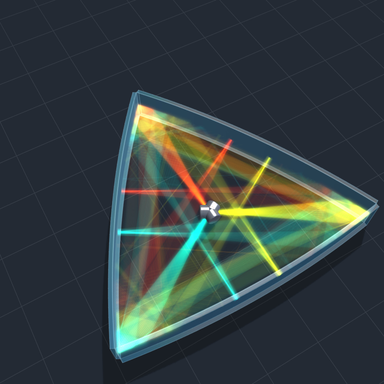

# Loomrume

  

Loomrume is a place to experiment with light. Examples, lessons, and your own schemes run on the same ray tracer, so you see what the physics does.

In [Studio](https://www.loomrume.com/studio) you place lamps, glass, and mirrors, move them, and the rays update. A scheme can also be opened in 3D. A textbook figure is already finished; here you can change one thing and watch the light respond.

The picture is computed, not a canned animation.

  <a href="https://www.loomrume.com/experiments/new"><strong>Open an empty bench</strong></a>
  ·
  <a href="https://www.loomrume.com/studio">Studio</a>
  ·
  <a href="https://www.loomrume.com/examples">Examples</a>
  ·
  <a href="https://www.loomrume.com/play">Lessons</a>
  ·
  <a href="https://apps.apple.com/app/id6830845640">App Store</a>

That link opens a new empty bench in your browser.

## More schemes

Each picture opens a fresh copy in Studio. The name goes to a short article.

<table>
  <tr>
    <td align="center" width="33%">
       
      <a href="https://www.loomrume.com/examples/malus-law"><strong>Malus’s law</strong></a>
    </td>
    <td align="center" width="33%">
       
      <a href="https://www.loomrume.com/examples/brewster-reflection"><strong>Brewster reflection</strong></a>
    </td>
    <td align="center" width="33%">
       
      <a href="https://www.loomrume.com/examples/galilean-telescope"><strong>Galilean telescope</strong></a>
    </td>
  </tr>
  <tr>
    <td align="center">
       
      <a href="https://www.loomrume.com/examples/newtonian-reflector"><strong>Newtonian reflector</strong></a>
    </td>
    <td align="center">
       
      <a href="https://www.loomrume.com/examples/planar"><strong>Planar</strong></a>
    </td>
    <td align="center">
       
      <a href="https://www.loomrume.com/examples/kaleidoscope"><strong>Kaleidoscope</strong></a>
    </td>
  </tr>
</table>

## On GitHub

The site does not host other people’s schemes. On GitHub they live in two repositories:

| | |
| --- | --- |
| [abyss](https://github.com/loomrume/abyss) | Community schemes. Send one from Studio (**Share → Send to Abyss**) or open a pull request. Search by code and by `kind:` labels on the PR. Issues are off. |
| [lantern](https://github.com/loomrume/lantern) | Support, bugs, ideas, and discussion. [Open an issue](https://github.com/loomrume/lantern/issues/new/choose) when you want us to act; [Discussions](https://github.com/loomrume/lantern/discussions) for conversation. Do not put schemes here. |

Curated examples on [loomrume.com/examples](https://www.loomrume.com/examples) are separate from Abyss.

## Links

| | |
| --- | --- |
| Site | [loomrume.com](https://www.loomrume.com) |
| Studio | [loomrume.com/studio](https://www.loomrume.com/studio) |
| Examples | [loomrume.com/examples](https://www.loomrume.com/examples) |
| Lessons | [loomrume.com/play](https://www.loomrume.com/play) |
| New scheme | [Empty bench](https://www.loomrume.com/experiments/new) |
| iPhone and iPad | [App Store](https://apps.apple.com/app/id6830845640) |
| Abyss | [github.com/loomrume/abyss](https://github.com/loomrume/abyss) |
| Support | [github.com/loomrume/lantern](https://github.com/loomrume/lantern) |
| Mail | [hello@loomrume.com](mailto:hello@loomrume.com) |

Studio also runs in the browser. The iPhone and iPad app is on the App Store. No account is required. Schemes stay on your device until you choose to share them.
